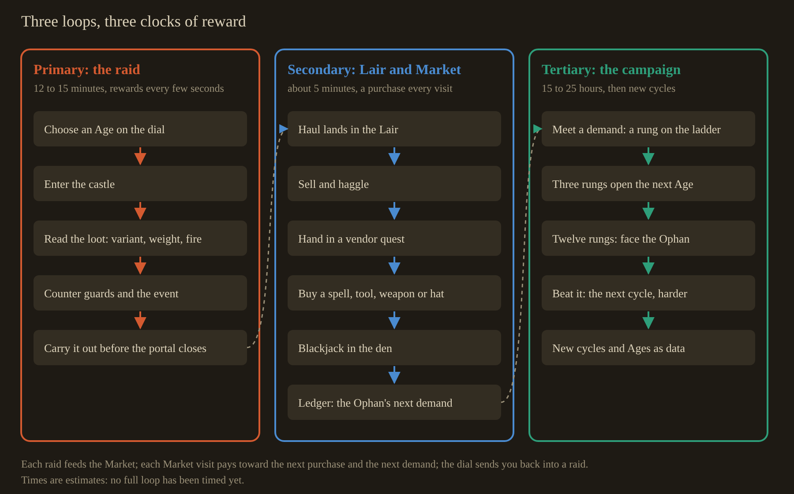
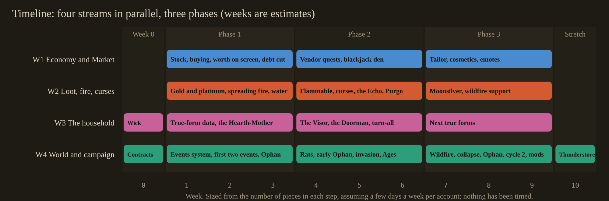

# Proposal: PlunderSpell's three loops, and how four people build them

> **Denied by the owner, 2026-10-25.** It decided too much at once. Kept only as a reference of ideas; nothing in it
> is agreed. Design now runs one area at a time (`docs/6-decisions/Decisions.md`, 2026-10-25, "Core-loops proposal
> denied").

Stage 3 of the core-loops work (`docs/plans/core-loops/README.md`), written 2026-10-25. It is built on the
approved analysis (`../analysis/analysis.md`), the owner's direction (`../owner-direction-2026-10-25.md`) and
the decision of 2026-10-25 in `docs/6-decisions/Decisions.md` (a new cycle after the Ophan; a campaign of 15
to 25 hours). The page version is `proposal.html` beside this file. Nothing here is built until the owner
approves it; the numbers in the tables are starting values for tuning, not measured results.

## What already exists, and what this merges, reuses or cuts

| Exists today | Where | What the proposal does with it |
|---|---|---|
| The raid loop: Lair, castle, extraction, Lair | `Raid/RaidDirector.cs` | Reused as the primary loop; gains event and quota hooks, nothing rewritten |
| The century dial that picks the Age | `Raid/LairCenturyDial.cs` | Reused as the "choose where you go" step; gains a threat preview on its plaque |
| Selling and haggling (*Plus*, *Satis*, *Vale*), four vendors, coin pouches, strongboxes | `Market/`, `Raid/SellCounter.cs`, `Raid/CoinPouch.cs`, `Raid/LairStrongbox.cs` | Reused; the Market gains a buying side, quests and a gambling den |
| The vendor slate | `Raid/CounterSlate.cs` | Reused as the quest board |
| The Collector's debt | `Market/CollectorRules.cs` | Cut, as the fear pass already decided (2026-10-11); the Ophan's demands replace it |
| Loot categories (Metal, Holy, Curio, Arms, Other) | `Loot/LootItem.cs` | Reused; variants are added beside the category, not instead of it |
| Fires that burn brighter with the alarm, and a burning status | `Atmosphere/FireRules.cs`, `Status/StatusEffectReceiver.cs` | Kept as the alarm's language; a separate spreading-fire system is added for flammable things |
| Lockdown doors | `Raid/CastleDoorSpawner.cs` (Decisions 2026-10-02) | Reused by the "vault seals" event |
| One guard brain for all 16 enemy types, and the Wick (the Lantern Warden's true form) | `Guards/`, branch `AjsAgent/fear-wick` (#417) | The Wick is merged first and is the model every other true form copies |
| The Ophan of Hours, designed (#418, #419) | `docs/7-design/fear-pass.md` on `AjsAgent/fear-wick` | Becomes the tertiary loop's ladder and its final confrontation |
| Earlier voice mimicry | branches `claude/voice-mimicry-improvements-7a0b29`, `claude/guard-mimic-prototype` | Mined for its microphone capture; stripped down to clip replay |
| Blackjack | `TheFallOfGoldenBay2D`, `Assets/Code/Scripts/Puzzles/BlackJackManager.cs` (378 lines) and `Card.cs` | Its flow and its event pattern are reused; the deck, scoring and authority are rewritten (see Blackjack) |
| Coins buy nothing | none | The gap this proposal closes first |

## The three loops

**Primary: the raid (about 12 to 15 minutes).** Choose an Age on the dial, step through the portal, find
and read the loot (its variant, its weight, whether it burns), avoid or counter the household and whatever
event is running, and carry what you can to the portal before it closes. The rewards are on the seconds
clock: a grab, a variant shine, a near miss, a teammate saved.

**Secondary: the Lair and the Market (about 5 minutes between raids).** The haul lands in the Lair. In the
Market you sell and haggle, hand in vendor quests, buy spells, tools, weapons and cosmetics, and gamble at
the blackjack table in its own den. Back in the Lair, the ledger shows the Ophan's next demand and the dial's
plaque shows what the next Age holds. The rewards are on the minutes clock: a purchase that changes what you
can do next raid.

**Tertiary: the campaign (15 to 25 hours, then repeatable cycles).** The Ophan's ledger is a ladder of
twelve demands, three per Age. Meeting an Age's third demand opens the next Age on the dial. After the
twelfth comes the confrontation with the Ophan in its own castle. Beating it starts the next cycle: the same
company, its spells, tools and cosmetics kept, its coin reset, facing a harder household, more events and a
new rung of rarer variants. A cycle is a data asset, so a future expansion adds a cycle, an Age or a set of
events without touching code. The rewards are on the hours clock: a new Age, a new rung, a new cycle.

The arithmetic behind 15 to 25 hours: a raid plus its Market visit takes about 20 minutes (12 to 15 in the
castle and 5 in the Market, an estimate, since no full loop has been timed yet). One demand every 3 to 5
raids, twelve demands, plus the confrontation, comes to 37 to 61 raids, which is 12 to 20 hours of raiding; failed demands, gambling and the confrontation bring it to
15 to 25. The tuning pass in phase 3 measures it.

## Loot variants

One data asset, `LootVariant`, rolled when a piece spawns. A piece has a category (who wants it) and at most
one material variant (gold or platinum), and may also carry a condition (flammable or cursed).

| Variant | Worth | Fragility | Weight | Behaviour | Counter | Spawn chance (start) |
|---|---:|---|---|---|---|---:|
| Plain | x1 | normal | normal | none | none | the rest |
| Gold | x2 | tougher: breaks at 1.5 x the plain threshold | x1.3 | none | none | 12% |
| Platinum | x3.5 | fragile: breaks at 0.5 x; each hard knock cracks it and drops a step of worth | x1.1 | a cold shine that guards see from further away | carry it slowly; Levo to float it past stairs | 4% |
| Flammable | x1 (cloth, wood, paper and wax pieces only) | normal | normal | catches fire within 1 m of a flame; burns to ash in 8 s; drops sparks that light rugs and tapestries | keep it away from torches; Aqua; any water source | 15% of eligible pieces |
| Cursed | x2.5 | normal | normal | one curse from a short list (below) | Purgo, a bought spell, cleanses it before or while you carry it | 3% (5% in later cycles) |

Curses, each a small rule:

- **The Echo (the mimic).** The piece listens while you carry it. After 40 s in hand, a copy of you (your
  colours, your hat, your name) walks out of the nearest dark doorway and wanders the castle, speaking in
  short clips of your own voice recorded during the raid. It kills on a catch, like a true form. Drop the
  piece or cleanse it before the 40 s run out, and nothing comes. This is the owner's "mask with a mimic mod".
- **The Weight.** The piece gets heavier every 20 s you hold it, until you must drop it or be slowed to a walk.
- **The Whisper.** The piece mutters; guards within 8 m hear it as if you spoke.

## The mimic voice

Stripped down to what Mirage and Skinwalkers do for Lethal Company: clip replay, no speech recognition and no
voice synthesis. While a raid runs, each player's own machine keeps a pool of short clips (1 to 4 s) cut from
moments the microphone was already live for casting. Clips are held in memory only, wiped when the game
closes, and sent to the other players only while an Echo of that player exists. A setting lets any player
opt out, in which case their Echo is silent. The microphone capture is mined from
`claude/voice-mimicry-improvements-7a0b29` and `claude/guard-mimic-prototype`; the speech parts of that work
are left behind.

## Fire and water

The alarm's fires stay what they are: the castle's mood ring. A new spreading-fire system sits beside them.

- **Flammable things.** Every furnishing and loot piece has a material: stone, metal, wood, cloth, paper,
  wax. Wood, cloth, paper and wax burn.
- **Ignition.** Torches, braziers and hearths, a burning guard, Ignis, a misfire, the Keeper of the Flame's
  pots, the Wick's light, and any burning piece carried near another.
- **Spread.** Fire jumps between burnable things within 1.5 m every 3 s, and a closed door slows it to every
  10 s. A room that fully burns goes dark and smoky.
- **A burning player** has 6 s to reach water, be doused by a teammate's Aqua, or go down. That is "not an
  immediate death sentence but a likely one".
- **Water.** Aqua, a spell bought in the Market, douses a cone 4 m long. Fixed water stands in set places,
  chosen per Age by the room generator: a cistern and water jars (Bronze), a well and horse troughs (High
  Medieval), a laver and rain barrels (Late Medieval), a fountain and fire buckets (Powder). A bucket, a tool
  from the Market, carries one douse.

## World events, each with its own warning signs

The owner's rule: "the fire can't be the only visual". Every event below has its own design for how the
players learn it is coming, chosen so no two events share a sign. Each one has:

- a **far sign**, readable from another room before the event reaches you;
- a **sound** with its own timbre, never borrowed from the alarm;
- a **clock in the world** that shows how long is left (a moon's height, a ram's rhythm, a crack's length);
- a **change in what the guards do**, so the household reacts too;
- a **counter** the players can learn, and a **reward** for facing it.

An event is a data asset (`WorldEvent`): trigger, chance, Ages, warning cues, phases, counter, reward. Random
events are rolled before a raid; action events fire when their trigger happens. At most one random event runs
per raid (see Choices).

### Events your actions set off

**The vault seals (greed).** *Trigger:* lifting a treasury's centrepiece from its pedestal.
*Far sign:* none; the warning is right there: the pedestal sinks a hand's width with a stone grind, and dust
sifts from every lintel between the treasury and the portal. *Sound:* counterweights ticking inside the walls,
slow at first, then faster. *Clock:* the portcullises drop room by room toward the treasury, in order, each
one preceded by a chain rattle overhead, so you can hear which door falls next. 90 s in all. *Guards:* the
household runs toward the treasury. *Counter:* put the piece back on the pedestal and the sequence stops;
Levo holds a falling portcullis up for 5 s; Velox to outrun it. *Reward:* the centrepiece is worth about
three ordinary hauls. *Reuses:* lockdown doors.

**Wildfire.** *Trigger:* the spreading fire reaches a third room. *Far sign:* smoke layers at ceiling
height and flows through doorways, so you can see which way the fire is moving; ash falls like snow.
*Sound:* timber cracking and a rising roar, low and continuous. *Clock:* the smoke layer drops toward the
floor; when it reaches head height, you choke and slow. *Guards:* the household abandons patrols to fight the
fire with buckets, carving a safe lane through rooms they leave. *Counter:* Aqua, the Age's fixed water,
closing doors. *Reward:* burnt tapestries and panelling reveal hidden alcoves with loot in them.

**The collapse.** *Trigger:* too much weight or force on an old upper floor: a petard, the Dendra Champion's
charge, or several heavy pieces dropped in one room. *Far sign:* cracks spread visibly across the ceiling
plaster and grow longer. *Sound:* a deep groan in the beams, and loose stones skittering down stairs.
*Clock:* the crack's length; every candle flame in the room leans toward the weak spot. *Guards:* they refuse
to enter the room. *Counter:* spread the weight, Levo pieces across, Saltus over the gap once it falls.
*Reward:* the floor drops into a sealed crypt or gives a shortcut down.

### Random events

**Plague rats.** *Roll:* about one raid in eight, High Medieval and later. *Far sign:* chalk crosses on
doors (the period's plague mark) and dead rats in corners from the moment you arrive; gnawed loot is already
worth less. *Sound:* scratching inside the walls, moving room to room. *Clock:* the swarms spread along the
skirting from room to room, and the gnawed rooms grow on the ledger map. *Guards:* infected guards cough,
loudly, every 20 s, so you can hear them coming. *Counter:* fire drives a swarm back (a torch, Ignis, a
burning piece thrown in); a touched player coughs too, every 20 s, a noise guards hear, until Purgo or the
Pardoner's remedy cures it. *Reward:* rooms the rats hold are empty of guards.

**The Ophan comes early.** *Roll:* about one demand raid in four, only on raids that carry a demand.
*Far sign:* time runs wrong: hourglasses run upward, candle wax climbs back up the candle, and a line of wall
briefly shows raw quarry rock where the Ophan will pass. *Sound:* a single high chord of its wheels, a little
louder each minute; the portal's hum goes out of tune. *Clock:* lapis light grows in the windows from
outside. *Guards:* they kneel and stop moving when the chord sounds. *Counter:* have the demanded artifact in
hand when it arrives; the artifact always spawns in a demand raid, so this never depends on luck. *Reward:*
hand it over early and the portal stays open 60 s longer.

**The full moon.** *Roll:* about one raid in eight, every Age. *Far sign:* the moon hangs huge and low in
every window from the start, and moonlight shafts creep across the floors as it rises. *Sound:* the Alaunt
war-hounds howl, and more often as it climbs; in other Ages, dogs in the courtyard do. *Clock:* the moon's
height in the windows; at moonrise (5 minutes in) every guard turns into its true form at once, as the Wick
turns. *Guards:* before moonrise they twitch, scratch, and stop on their rounds to stare at windows.
*Counter:* be out, or be ready: every true form's own counter still works. *Reward:* moonsilver, a variant
worth x5 that spawns only on full-moon nights (chance-gated, so optional).

**The invasion.** *Roll:* about one raid in eight, every Age; the invaders are the next Age's household.
*Far sign:* the guards leave their posts and run for the walls, so the inner castle empties; fire arrows
thud into shutters. *Sound:* war horns outside, then a ram on the front gate, one blow every 8 s, faster each
time. *Clock:* the ram's rhythm. *Guards:* they fight the invaders, and the invaders fight everyone,
including you; invaders also carry off loot. *Counter:* let them fight, stay out of the gatehouse, use the
empty keep. *Reward:* the invaders' war chest, dropped where their captain falls.

### Later events

Bosses summoned at an altar with a key (Lycanites Mobs' rule), a storm that wets powder, a feast that fills
the hall with drunk guards. Each is just another `WorldEvent` asset once the framework exists.

## The household's true forms

Every enemy type gets a true form with one sense, one attack, one tell and one counter, the Wick's pattern.
The human form can still be stunned by a hard blow to the head; the true form can only be escaped or
countered. Phase 1 builds one per Age (marked **first**); the rest follow.

| Age | Enemy | True form | Sense | Attack | Tell | Counter |
|---|---|---|---|---|---|---|
| Bronze | Palace Levy | The Furrow | feels footsteps and dropped loot through the floor | bursts up beneath you | a line of floor tiles lifting toward you | stand still on a rug or a table; it loses you |
| Bronze | Wall Slinger | The Whirr | hears | a stone that knocks the piece out of your hands | the sling's whirr rising in pitch | duck behind cover when the pitch peaks |
| Bronze | Dendra Champion | The Bell | blind; hears and charges | a charge that cannot turn | it rings louder before it runs | sidestep so it hits a wall and stuns itself |
| Bronze | Keeper of the Flame | **The Hearth-Mother (first)** | sees heat: burning things, cast spells, carried flammables | throws fire pots that start the spreading fire | the clink of clay pots on her yoke | Aqua douses her pots; throw a burning piece to lure her away |
| High Medieval | Lantern Warden | **The Wick (built, #417)** | sees only inside its own fire's light | catches and kills | its light swells as it turns | stay outside its light; the hood dims yours |
| High Medieval | Castle Crossbowman | The Windlass | long sight down straight corridors | a bolt that pins you to a wall for 4 s, until a teammate pulls you free | the long click of the windlass spanning | close in while it spans (6 s) or break the line |
| High Medieval | Household Knight | The Tithe | smells worth: follows the most valuable carried piece | grabs that piece and you with it | its helm turns to track your pocket | drop the piece to lure it, then circle back |
| High Medieval | Alaunt War-hound | The Hush | hears voices, so it hears every cast | lunges and drags you to its kennel | its breathing stops when it hears you | stay silent near it; cast nothing |
| Late Medieval | Sallet Halberdier | **The Visor (first)** | moves only when nobody is looking at it | a halberd sweep | the scrape of plate when you look away | keep someone's eyes on it while the others move |
| Late Medieval | Handgunner | The Match | smells the slow match: sees in its glow | one deafening shot that wakes the whole castle | the red glow of the match | Aqua puts out the match, and it cannot fire |
| Late Medieval | Gothic Man-at-Arms | The Harness | sight | breaks apart when struck and re-forms in 10 s | the plates rattle as they gather | Levo carries its helm away, so it cannot re-form |
| Late Medieval | Pavisier | The Wall | sight | plants itself in a doorway and seals you in with the others | the pavise grinding on the floor | Saltus over it, or a second door |
| Powder | Palace Guard | **The Doorman (first)** | it is a door, and waits | the door you open is its mouth | hinges on the wrong side, warm to the touch, no creak | Porta knocks first: a real door creaks, it does not; chalk marks doors you have checked |
| Powder | Musketeer | The Volley | sight | a shot through wooden walls | the forked rest planted, the match lowered | water wets the powder; rain events stop it |
| Powder | Cuirassier | The Rider | hears hooves of its own horse; fast in long corridors | a run that cannot take corners | hooves where there is no horse | turn corners; it overshoots |
| Powder | Petardier | The Fuse | drawn to doors and to players | it blows, and can start a collapse | the hiss of its fuse | Aqua puts out the fuse, or lure it to a door you want open |

## The Market and the economy

**What coin buys.** Each piece of stock counters a named threat, as Lategame Upgrades' do.

| Kind | Examples | Counters | Price (start) |
|---|---|---|---:|
| Spells | Somnus, Aqua, Purgo, Velox, Saltus (in that order) | guards, fire, curses and plague, the chase, gaps | 1,000 to 6,000 |
| Tools | hood (dims your light), bucket, chalk, hand mirror (look behind without turning), sounding rod (feels the Furrow), meat (the Hush) | named true forms and events | 50 to 800 |
| Weapons, each a play style | cudgel (a stun to the head, close), sling (a stun from range, quiet), throwing net (holds a human form 6 s), censer (a smoke screen) | human forms only; nothing kills a true form | 300 to 2,500 |
| Lair rooms | a second strongbox, a trophy wall, a map table | comfort and showing off | 2,000 to 8,000 |
| Cosmetics and emotes | hats, robe trims and colours, emotes on a wheel, sold at a fifth stall, the Tailor | nothing: looking like yourself is progress | 100 to 2,000 |

An early raid brings home roughly 200 to 600 coin; a late one 2,000 to 4,000 (starting values, to be tuned).
Each tier of stock costs two to three raids at the level you are on, so there is always a next purchase in
sight, as in How to Fish.

**Vendor quests.** Each vendor pins one or two quests to their slate: a named category, an Age, a minimum
condition, sometimes a variant ("a Holy piece of the High Medieval, gold or better"). A quest pays 1.5 x the
piece's price plus a named reward (a tool, a cosmetic, a discount). Quests are optional, so they may depend on
luck; the Ophan's demands never ask for a variant unless it is guaranteed to spawn.

**Numbers on screen.** The owner asked for worth to "go up or down visibly on your screen". That reverses part
of the diegetic decision (`docs/7-design/diegetic-ui-lair-market.md`: "the number goes"). The choice is below.

## Blackjack

In its own den at the back of the Market, with its own dealer. The Fall of Golden Bay 2D's code gives the
flow (deal, player turn, dealer turn, result) and the event pattern (`BlackJackWinEvent`,
`BlackJackLoseEvent`, `BlackJackTieEvent` through `EventManager`), which PlunderSpell already uses. What
changes:

| Golden Bay 2D | PlunderSpell |
|---|---|
| draws from an endless deck with `Random.Range` | a six-deck shoe, shuffled from the raid seed, reshuffled at 75% |
| an ace is always 11 | soft aces (11, or 1 if 11 would bust) |
| no betting | you bet by placing coin pouches on the felt; blackjack pays 3 to 2, a win 1 to 1 |
| single player, UI canvas | up to four players at a 3D table; the host deals (server authority, PurrNet) |
| wins needed to pass a puzzle | a table limit per Age, so a run cannot be lost in one hand |
| buttons | *Plus* to hit, *Satis* to stand (the haggle words), keys as well |

In-game coin only, never real money, which keeps the rating risk Balatro hit away. "Hail Mary" bets that can
save a run (double or nothing on a whole haul with the Fence) come later.

## The stakes

| What happens | What you lose | What you win |
|---|---|---|
| You die in a raid | what you were carrying; your hat stays where you fell | nothing; a teammate can still carry you out |
| The whole company dies | the raid's haul | nothing; the Lair, coin and purchases are kept |
| The Ophan arrives and you are empty-handed | your life that raid; the rung does not advance; the artifact spawns again next raid | the rung, and the next Age once an Age's three are met |
| You lift a centrepiece | time, perhaps the run | about three hauls' worth |
| You carry a cursed piece | an Echo of you in the castle | x2.5 worth |
| You take a quest | nothing | 1.5 x and a named reward |
| You play blackjack | the stake | 1 to 1, or 3 to 2 on a blackjack |
| Fire takes a room | burnt loot, perhaps a teammate | hidden alcoves |
| You beat the Ophan | nothing | the next cycle, harder, with rarer variants |

## Mods: content as data first, Thunderstore later

Variants, events, curses, vendor stock, quests, guard tuning and cycles are all data assets
(ScriptableObjects). That is the "less with more" rule, and it is also the base of mod support: phase 3 adds
a loader that reads the same definitions from JSON in a mods folder; publishing on Thunderstore is a stretch
goal after that.

## The timeline

The weeks are an estimate sized from the number of pieces in each step, assuming each account works on its
stream a few days a week; nothing has been timed.

- **Week 0.** Merge the Wick (`AjsAgent/fear-wick`, #417), pull request #414 (the Wick and the Ophan's art) and pull
  request #422 (the Lair pile that keeps its place) into
  `staging-2026-10-11`. W4 publishes the shared contracts (`docs/4-systems/core-loops-contracts.md`) and the
  `ContentDef` base data asset. The others start inside their own folders.
- **Phase 1, weeks 1 to 3: coin buys things, loot has variants, the first events and true forms.**
- **Phase 2, weeks 4 to 6: quests, blackjack, curses and the mimic, the rest of the phase 1 events, the
  Ophan's ladder and Ages unlocking.**
- **Phase 3, weeks 7 to 9: cosmetics and emotes, wildfire and collapse, the next true forms, the Ophan's
  confrontation, the next cycle, a timed tuning pass of the 15 to 25 hours, and the mod loader.**
- **Stretch, week 10 on: Thunderstore.**

## Four workstreams

Each has a self-contained brief in `briefs/`. The rule for overlap: each stream owns its folders; a stream
that needs another's system asks through an event or an interface defined in the shared contracts, never by
editing the other's files.

| Stream | Brief | Owns | Delivers |
|---|---|---|---|
| W1 Economy and Market | `briefs/W1-economy-market.md` | `Market/`, `Raid/SellCounter.cs`, `Raid/CounterSlate.cs`, `Raid/VendorLines.cs`, `Raid/HaggleVoiceRouter.cs`, `Raid/CoinPouch.cs`, `Raid/LairStrongbox.cs`, new `Shop/` and `Gambling/` | buying, prices, worth on screen, quests, blackjack, the Tailor, cosmetics and emotes |
| W2 Loot, fire and curses | `briefs/W2-loot-fire-curses.md` | `Loot/`, `Raid/LootSpawner.cs`, `Raid/LootPlacementPlanner.cs`, `Raid/RaidLootTable.cs`, `Atmosphere/Fire*`, `Status/`, new spells Aqua and Purgo in `Spells/`, new `Mimic/` | variants, flammable things, spreading fire, water, curses, the Echo and its voice clips |
| W3 The household | `briefs/W3-household.md` | `Guards/`, `Enemies/`, `Alarm/`, `Raid/EnemyRoster.cs`, `Raid/GuardSpawner.cs`, `Raid/GuardPlacementPlanner.cs`, art in `Ajw2003/claude-art-pipeline` | the Wick merged, then true forms one per Age, then the rest |
| W4 World and campaign | `briefs/W4-world-campaign.md` | new `Events/`, `Raid/RaidDirector.cs`, `Lair/`, `Raid/LairCenturyDial.cs`, `Raid/LairLedgerBook.cs`, `Core/Contracts/`, `docs/4-systems/core-loops-contracts.md` | the contracts, the event framework, all seven events, the Ophan's ladder and confrontation, cycles, Age unlocks, the threat preview, the mod loader |

Known touch points, all settled through the contracts:

- W2's fire raises `FireSpreadEvent`; W4's wildfire event listens for it.
- W4 asks W2's loot spawner to pin a demanded artifact through `ILootPinRequest`.
- W1 records what the company owns; W2's spells and W3's tools read it through `IOwnedContent`.
- W3's true forms raise `TrueFormTurnedEvent`; W4's full moon calls `ITurnAll`.

## Choices for the owner

1. **Numbers on screen.** A (suggested): numbers appear in the Lair and Market at the moment of change
   (a sale's "+240", the purse tally, price tags), while the raid stays without numbers. B: numbers everywhere,
   the raid's haul worth included. C: keep the diegetic rule, no numbers.
2. **How often random events come.** A (suggested): about one raid in two has a random event, never two at
   once; action events whenever triggered. B: every raid has one. C: about one raid in four.
3. **How Ages unlock.** A (suggested): by the Ophan's ladder, three demands per Age. B: bought in the Market.
   C: all four open from the start.
4. **How many true forms first.** A (suggested): one per Age (the Wick finished, the Hearth-Mother, the
   Visor, the Doorman). B: two (the Wick and the Hearth-Mother). C: all four of one Age.
5. **Which events first.** A (suggested): the vault seals and the full moon, which reuse lockdown doors and
   the true forms. B: plague rats and the invasion, which are newer content but more to build.
6. **The Echo's voice clips.** A (suggested): clips recorded on each player's machine, sent to the others only
   while that player's Echo exists, kept in memory and wiped on quit, with an opt-out. B: no clips leave a
   machine, so only you hear your own Echo (much less frightening).

## Next steps once approved

1. Open a parent issue for the core loops and one issue per stream, each with its steps, dependencies and
   done-criteria, labelled `AjsAgent created this`, a category, and `in progress`.
2. W4 writes the contracts and the systems document `docs/4-systems/core-loops-contracts.md`.
3. Start four threads, one per stream, each pointed at its brief; each brief also works pasted into a session on
   another of the owner's accounts.
4. Merge the Wick and #414 and #422 first, so every stream starts from the same base.
